# DocAssist: Processes and Diagrams

How a document becomes searchable knowledge, and how a question becomes a cited answer. The diagrams are written in [Mermaid](https://mermaid.js.org/). They render on GitHub and in editors with Mermaid support, and every one is also exported as an image in [`docs/diagrams/`](diagrams/).

*Updated 2026-10-05 for AI providers with fallback, pgvector and Docker.* After editing a diagram, regenerate the SVGs: the render script loads Mermaid in headless Chrome and writes one `diagrams/NN-name.svg` per block, in order.

**Contents**

1. [Use case diagram](#1-use-case-diagram)
2. [Component diagram](#2-component-diagram)
3. [Deployment diagram](#3-deployment-diagram)
4. [Activity diagram: uploading and indexing a document](#4-activity-diagram-uploading-and-indexing-a-document)
5. [State machine: document lifecycle](#5-state-machine-document-lifecycle)
6. [Sequence diagram: upload and indexing](#6-sequence-diagram-upload-and-indexing)
7. [Activity diagram: answering a question](#7-activity-diagram-answering-a-question)
8. [Sequence diagram: a question in the web app (streamed)](#8-sequence-diagram-a-question-in-the-web-app-streamed)
9. [Sequence diagram: a question through the API](#9-sequence-diagram-a-question-through-the-api)
10. [Class diagram: data model](#10-class-diagram-data-model)
11. [Data flow: what stays on the server and what leaves](#11-data-flow-what-stays-on-the-server-and-what-leaves)
12. [Technology summary](#12-technology-summary)

---

## 1. Use case diagram

Who interacts with the system, and what each actor can do.

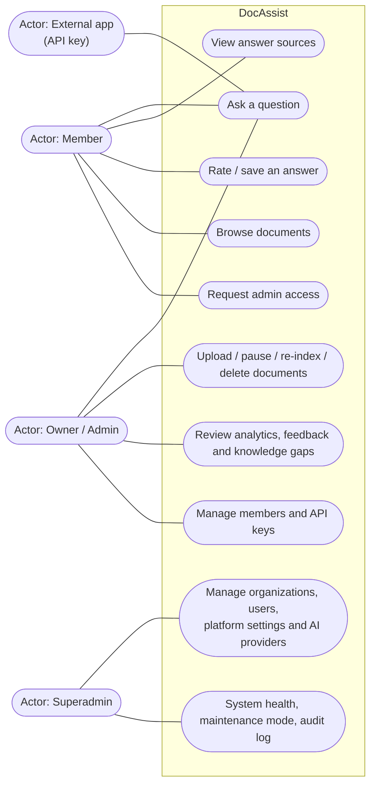

- **Members** ask questions, see the sources behind each answer, rate or save answers, and can request admin access.
- **Owners / admins** do everything members do, and also maintain the knowledge base, review usage and manage people and keys for their organization.
- **Superadmins** operate the platform across all organizations: platform settings, AI providers and their order, maintenance mode, health and the audit log.
- **External apps** ask questions through the REST API, each authenticated by an organization's API key.

---

## 2. Component diagram

The main parts of the system and how they depend on each other.

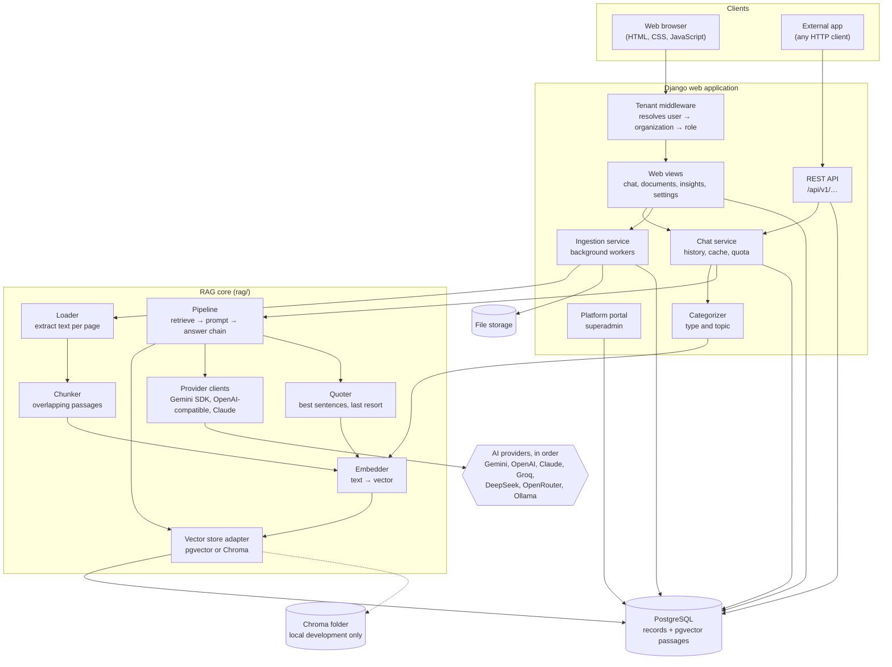

| Component | Responsibility |
| --- | --- |
| Tenant middleware | Identifies the user, picks their current organization and role for every request |
| Web views / REST API | Accept requests, enforce permissions, return pages or JSON |
| Ingestion service | Turns an uploaded file into stored, searchable passages, in the background |
| Chat service | Applies quotas, gathers conversation history, uses the answer cache, stores questions and answers |
| Categorizer | Labels each question with a type and the closest topic |
| RAG core | Loader, chunker, embedder, vector store (pgvector or Chroma), pipeline, provider clients and quoter: the retrieval-augmented generation logic, independent of the web layer |
| Answer chain | Tries the enabled AI providers in order; if all fail, quotes the best-matching sentences |
| Platform portal | Cross-organization administration for superadmins: organizations, users, platform settings, AI providers, health, audit, maintenance |

---

## 3. Deployment diagram

What runs where, in the Docker setup.

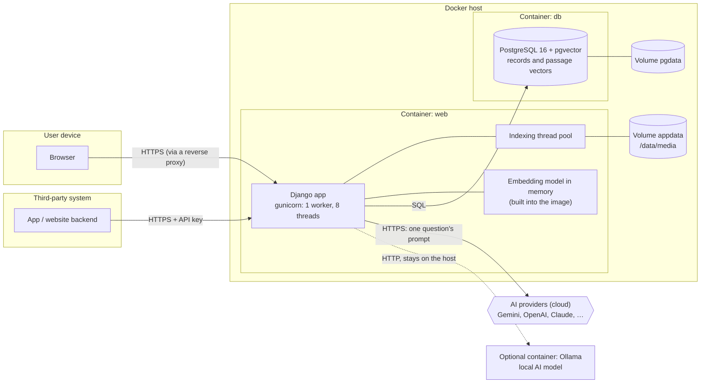

- The **web** container holds the embedding model and runs migrations and `setup_pgvector` on start; a warm-up loads the model so the first question doesn't wait.
- The **db** container stores everything, including the passage vectors with an HNSW index, so one database backup covers it all.
- The only calls leaving the host go to cloud AI providers, and none do for organizations that switch external AI off.
- Local development can run without Docker, on SQLite or PostgreSQL with Chroma for vectors.

---

## 4. Activity diagram: uploading and indexing a document

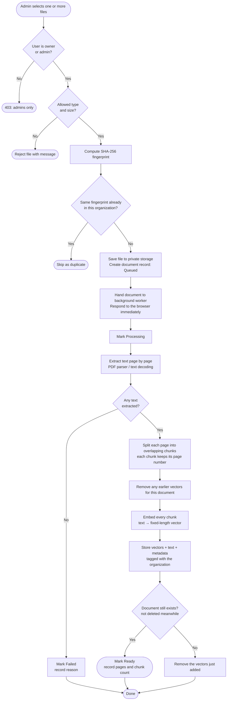

**What happens at each step**

| Step | What is done |
| --- | --- |
| Permission check | Only owners and admins of the current organization may upload |
| Validation | File type (PDF, TXT, Markdown) and maximum size are checked before anything is stored |
| Fingerprint | A SHA-256 hash of the content identifies duplicates, even when a file is renamed |
| Save | The original file goes to private storage under the organization's folder. A database record is created with status *Queued*. |
| Hand-off | Indexing runs in the background, so the upload request returns at once |
| Extract | Text is read page by page; text files are decoded with encoding fallbacks |
| Split | Text is cut into overlapping passages of a configured size; overlap keeps sentences that cross a boundary intact |
| Embed | A local model converts each passage into a vector that represents its meaning |
| Store | Vectors, passage text and metadata (organization, document, file name, page) are written to the vector store: the pgvector passage table, or the organization's Chroma collection |
| Finish | The record becomes *Ready* (or *Failed* with the reason). A document deleted during indexing leaves nothing behind. |

---

## 5. State machine: document lifecycle

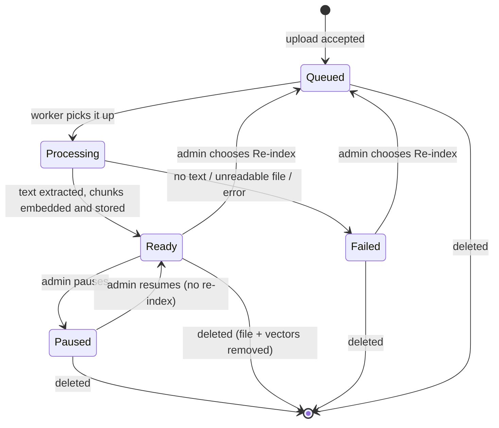

Only *Ready* documents that aren't paused are searched when answering questions. Pausing keeps the file and its passages, so resuming is instant. Deleting a document removes its file and only its own vectors; other documents are untouched.

---

## 6. Sequence diagram: upload and indexing

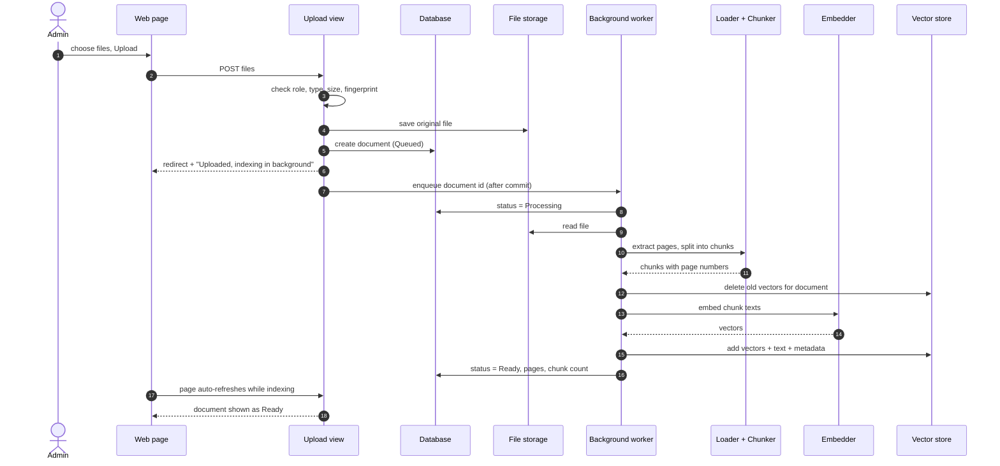

---

## 7. Activity diagram: answering a question

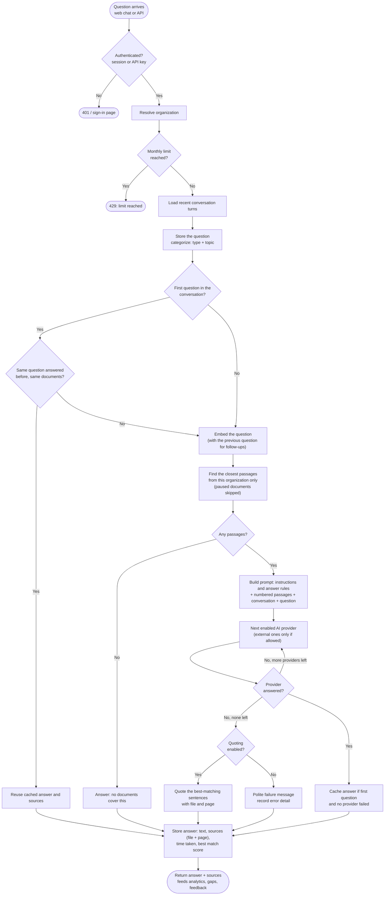

**What happens at each step**

| Step | What is done |
| --- | --- |
| Authenticate | Web: session login. API: bearer key, hashed and looked up, revoked keys rejected. |
| Organization | Web: the user's current organization. API: the key's organization. |
| Quota | Optional monthly question limit per organization |
| History | The last few question/answer pairs are loaded so follow-up questions make sense |
| Categorize | The question gets a **type** (greeting, about the assistant, follow-up, document question) and the nearest admin-defined **topic** using the local model |
| Cache | A first question identical to an earlier one, with unchanged documents and settings, is answered instantly |
| Retrieve | The question is embedded with the same model used at upload; the vector store returns the most similar passages from this organization only |
| Prompt | Instructions, numbered passages with file and page, recent conversation, and the question |
| Generate | The enabled AI providers are tried in order until one answers; in the web app the answer streams word by word. If all fail, the best-matching sentences are quoted instead. Which provider answered, and why earlier ones failed, is recorded. |
| Store | The answer, its sources, the time taken and the best match score are saved. These drive Home, Analytics, Questions, Feedback and Knowledge gaps. |

---

## 8. Sequence diagram: a question in the web app (streamed)

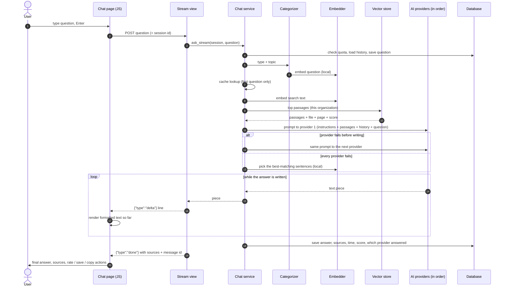

---

## 9. Sequence diagram: a question through the API

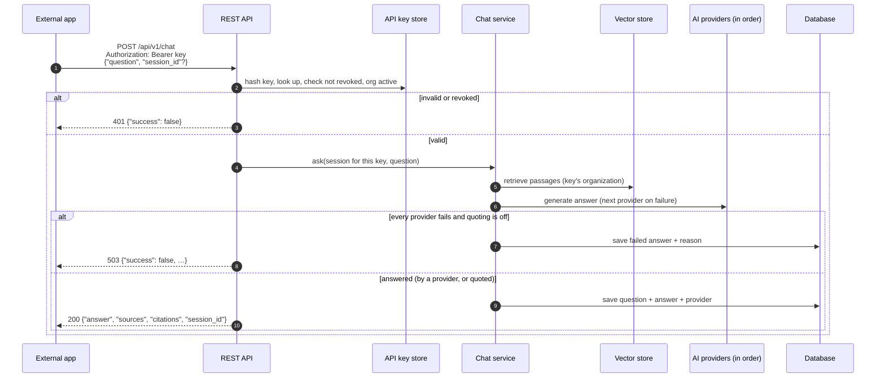

Other endpoints: `GET /api/v1/documents`, `GET /api/v1/validate-key`, `GET /api/v1/health`. Error codes: 400 bad input, 401 key, 405 method, 429 monthly limit, 503 AI unavailable with quoting off, or maintenance mode.

---

## 10. Class diagram: data model

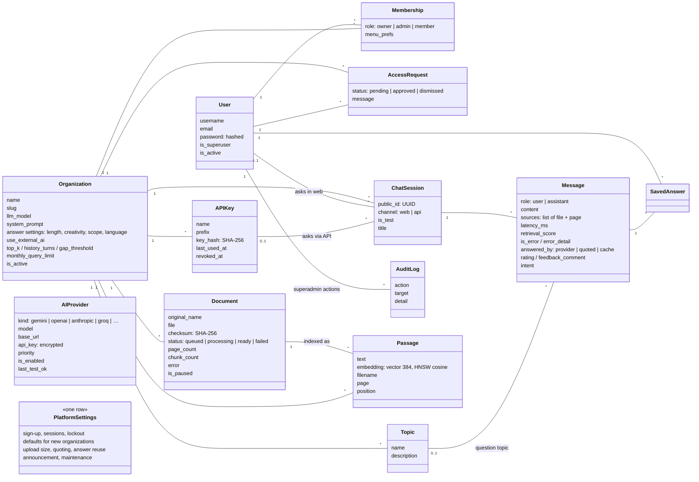

With the pgvector backend, `Passage` is a PostgreSQL table like the rest; with Chroma, the same data lives in one Chroma collection per organization. `AIProvider` and `PlatformSettings` are platform-wide. Every organization-owned record carries its organization, which is how tenants are kept apart.

---

## 11. Data flow: what stays on the server and what leaves

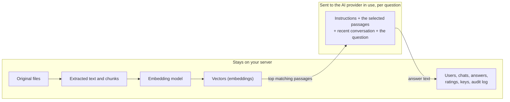

- Uploading, extracting, splitting, embedding, searching and categorizing all happen locally.
- For each question, only the small set of retrieved passages and the conversation context are sent to the AI provider that answers. Whole documents are never sent.
- Nothing leaves the server when an organization switches external AI off, when a local (Ollama) provider answers, or when the answer is quoted.
- API keys are stored only as hashes; AI provider keys are encrypted; passwords use Django's salted hashing.

---

## 12. Technology summary

| Layer | Technology | Used for |
| --- | --- | --- |
| Web framework | Django 5.2 (Python 3.10) | Pages, REST API, authentication, permissions, admin |
| Relational database | PostgreSQL 16 (SQLite also works for development) | Users, organizations, documents list, chats, ratings, keys, settings, audit |
| File storage | Local disk (`media/`) | Original uploaded documents |
| Text extraction | pypdf; Python text decoding | Reading PDF pages and text files |
| Chunking | LangChain `RecursiveCharacterTextSplitter` | Overlapping passages with page numbers |
| Embeddings | sentence-transformers `all-MiniLM-L6-v2` on PyTorch | Turning text into 384-number vectors, locally |
| Vector search | pgvector 0.8 in PostgreSQL (HNSW, cosine); ChromaDB for local development | Storing and searching passages, filtered by organization |
| Answer generation | AI providers in order: Gemini (`google-generativeai`), OpenAI-compatible APIs (OpenAI, Groq, DeepSeek, OpenRouter, Ollama), Anthropic Claude; quoting as last resort | Rewording the passages found into cited answers; streaming |
| Background work | Python thread pool | Indexing uploads without blocking requests |
| Caching | Django cache framework | Instant answers to repeated questions |
| Front end | Server-rendered HTML, CSS, vanilla JavaScript; marked + DOMPurify | Interface, streaming chat, safe Markdown rendering |
| Secrets | `cryptography` (Fernet) | Encrypting AI provider keys |
| Deployment | Docker Compose: gunicorn web container + `pgvector/pgvector:pg16`; WhiteNoise for static files | Production hosting |
